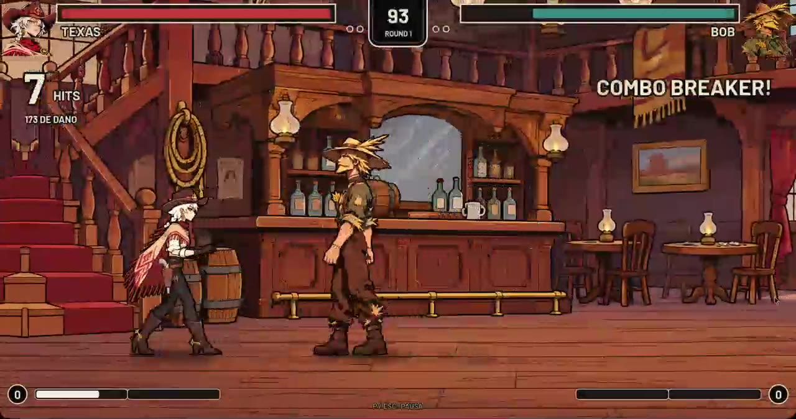

# Close Combat

Jogo de luta 2D para navegador de computador, com arte ilustrada original, simulação determinística e foco em leitura de ações, domínio de distância, pressão e defesa.

[](docs/media/lutas-close-combat.mp4)

*Texas em ação: um combo quebrado por combo breaker, um combo completo, a ultimate dela na Praia e a ultimate do SM0G-000 contra ela. Clique na imagem para ver o vídeo.*

## Proposta

Close Combat quer ser um jogo de luta de ritmo rápido em que cada ação é legível: antecipação, contato e recuperação aparecem com clareza, e o jogador sempre sabe por que ganhou ou perdeu uma troca. A intenção de ritmo vem dos anime fighters, e a linguagem visual, de ilustração 2D com contorno expressivo, cores chapadas e sombras recortadas, inspirada em jogos como Hades e na animação tradicional desenhada à mão. São referências de intenção; os desenhos, as regras e os personagens são originais.

Princípios do projeto:

- **Legibilidade antes de tudo.** Sem bastidores escondidos: o motor decide as regras, e a apresentação nunca altera o gameplay.
- **Cada personagem é um estilo de jogo.** Cada kit tem dados, golpes e combos próprios, escritos à mão, e não derivam de um arquétipo genérico.
- **Treino de verdade.** Modo treino, tutorial com exemplos e combos avançados testados na própria simulação.
- **Jogo para todos.** Oito idiomas, controles remapeáveis e suporte a controle (gamepad).

## Estado atual

### Já implementado

- **Modos:** Arcade, Treino, Tutorial e PvP local.
- **Tutorial completo:** movimento, golpes básicos, combos, combos avançados e uma seção de rage (reforço de especial, Rage Rush e combo breaker).
- **Sistemas de combate:** quique na parede, combo breaker, Rage Rush e ultimates.
- **Personagens (3), em 3 arquétipos iniciais:** Bob (Shoto), Texas (Zoner) e SM0G-000 (Grappler).
- **Cenários (3 iniciais, 6 contando variações e treino):** Fazenda, Saloon (Dia, Noite e Retrô), Praia e a Sala de treino.
- **Idiomas (8):** português, inglês, espanhol, italiano, alemão, japonês, coreano e mandarim.
- **Controles:** teclado remapeável para os dois jogadores e suporte a controles de jogo.

### Em planejamento

- **Modo roguelike,** que será o modo principal do jogo.
- **Mais conteúdo:** 6 novos cenários, com interações próprias e propriedades únicas.
- **6 novos personagens,** cobrindo os principais arquétipos dos jogos de luta: Puppet, Gimmick, Rushdown, Stance, Mixup e Setplay.
- **Combate e flow melhorados** e um sistema de Rush aprimorado.
- **Áudio:** voz de narrador e músicas para os cenários.
- **Progressão:** sistema de maestria e rank por personagem.
- **Online:** modo online e matchmaking.
- E o que mais surgir pelo caminho.

Os números, as listas de tarefas e a situação detalhada de cada peça ficam na [pipeline](pipeline.md); este resumo é só uma visão geral.

## Executar

Usar Node.js 22 e npm.

```sh
npm ci
npm run dev
```

## Validar

```sh
npm test -- --run
npm run build
git diff --check
```

As rotas de exemplo e os combos avançados do tutorial vêm de `npm run combos:find`, que testa entradas legais na simulação e grava `src/training/comboRoutes.json`; refazer após mudar golpes ou receitas (os testes acusam rotas desatualizadas).

Para conferir a versão compilada, executar `npm run preview`. Mudanças visuais e de controles também precisam de revisão no navegador; testes e build não comprovam qualidade visual.

## Organização

`src/engine/` contém simulação, dados, colisão e combate; `src/input/` adapta entradas; `src/rendering/` apresenta o estado; `src/scenes/` organiza o fluxo; `src/ui/` e `src/training/` oferecem interface e ferramentas. Assets ativos ficam em `src/assets/`; referências canônicas e metadados de arte em `assets/art/`. Testes ficam em `src/tests/`.

O motor decide as regras; a apresentação não altera gameplay. Controles são remapeáveis. Dados e manifestos descrevem cada conteúdo, e seus detalhes de design pertencem exclusivamente à pipeline.

## Documentos

- [Base](base.md): princípios e decisões gerais.
- [Identidade visual](identidade-visual.md): linguagem artística e critérios de produção.
- [Pipeline](pipeline.md): conteúdo específico, estado do trabalho, tarefas e validações.
